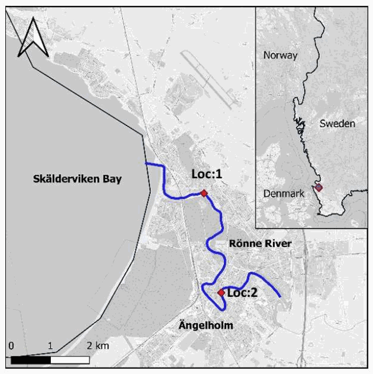
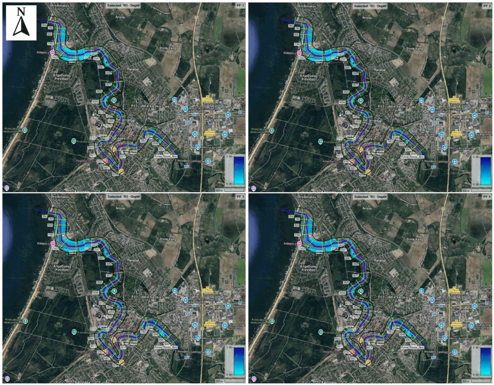
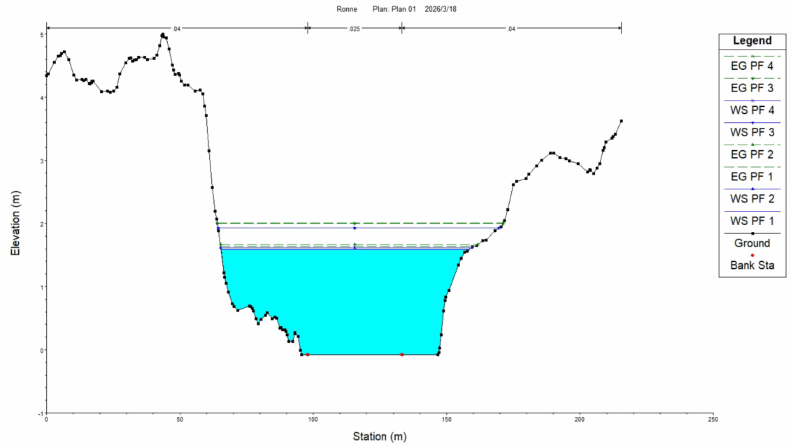
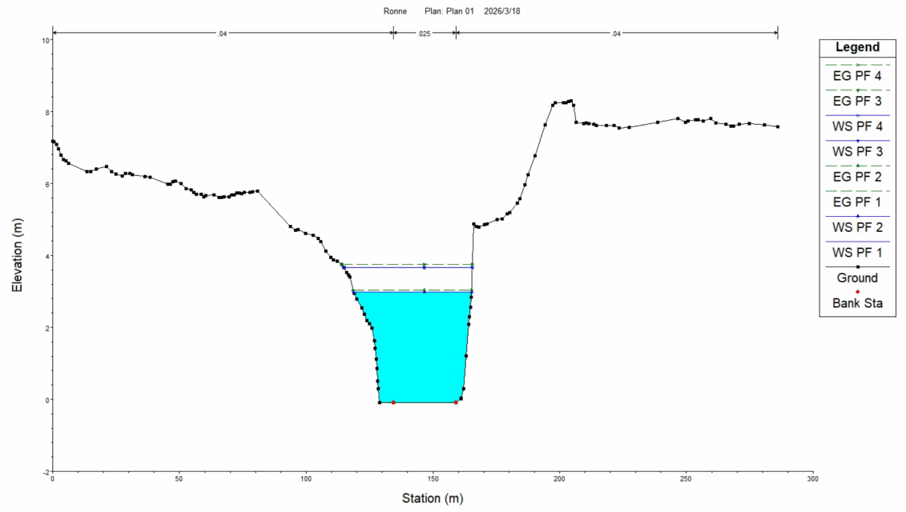
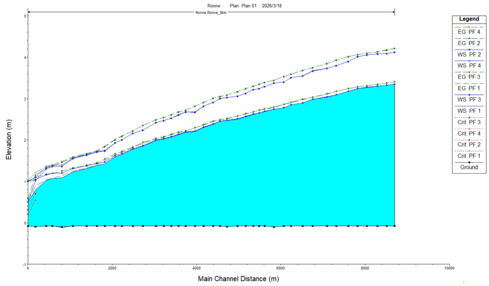

# Figures / 图集

[Project](../README.md) · [中文说明](../README.zh-CN.md)

Figures are extracted from the project report. Original map and image source credits remain those of the report.

## Study area and evaluation points

Source: project report, PDF page 3.

## Depth maps for four boundary scenarios

Source: project report, PDF page 5.

## Cross-section water levels at RS 2422

Source: project report, PDF page 5.

## Cross-section water levels at RS 7107

Source: project report, PDF page 6.

## Longitudinal water-surface profiles

Source: project report, PDF page 7.

